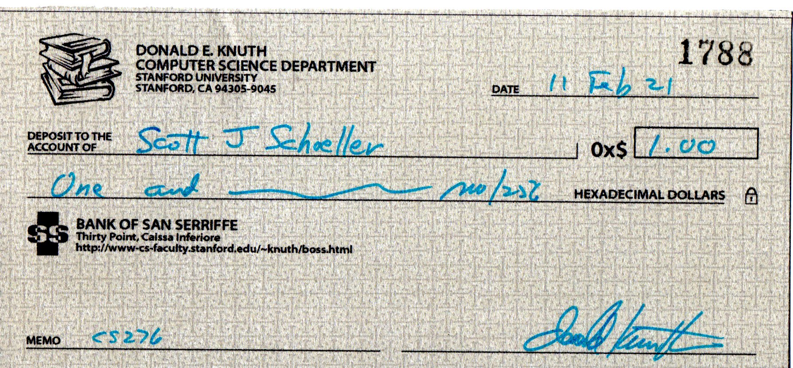
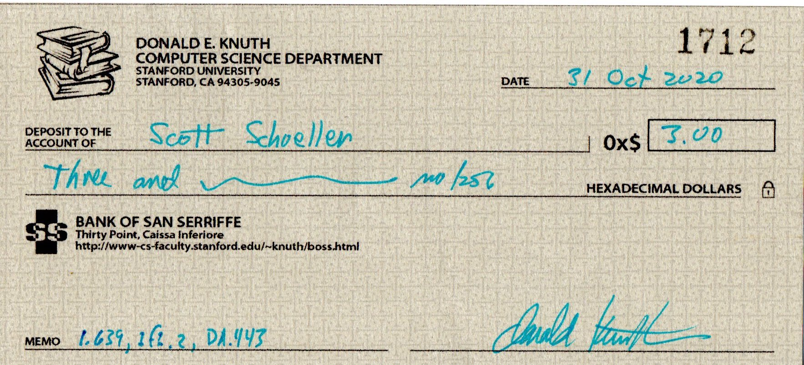
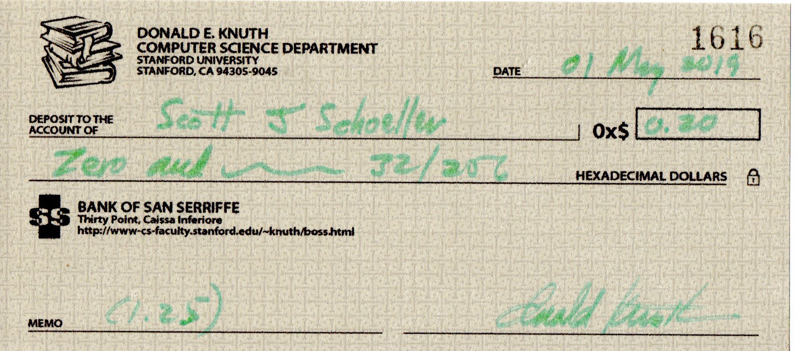

<body>
 
<h1>About Me...</h1>

I am well-rounded in scientific subjects, especially biology, chemistry and environmental studies, and last but not least, computer science!
I have been <a href="pubs.html">co-published</a> three times in the field of protein biochemistry and completed a bioinformatics thesis.
My favorite accomplishments (thus far!) surround earning three <a href="https://en.wikipedia.org/wiki/Knuth_reward_check">Knuth Reward Checks</a>. The corrected books were Volume 1 and Volume 1 Fascicle 1 of <i><a href="https://www-cs-faculty.stanford.edu/~knuth/taocp.html">The Art of Computer Programming</a></i>, <i><a href="https://www-cs-faculty.stanford.edu/~knuth/da.html">Selected Papers on Design of Algorithms</a></i>, as well as <i><a href="https://www-cs-faculty.stanford.edu/~knuth/cs.html">Selected Papers on Computer Science</a></i>.

&nbsp;&nbsp;
 

 
I am starting a <a href="statelineosdg.html">regional open source group</a>.
 
Additional achievements include membership in <a href="https://www.phikappaphi.org/">The Honor Society of Phi Kappa Phi</a> and various scholarships.

 
<h2>Education</h2> 
Master of Science, Computer Science, <a href="https://www.uww.edu/">UW-Whitewater</a>, May 2021 
Add-on Minor*, Computer Science, UW-Whitewater, May 2018 
Bachelor of Science, Chemistry--Professional ACS Approved (Environmental Studies minor), UW-Whitewater, Dec 2014 
*<a href="https://uww-public.courseleaf.com/general-information/registrars-office/undergraduate-policies/#addingamajorminortoadegreetext">UW-Whitewater allows adding on a minor to an existing degree earned there</a> 
<h3>Electives Taken</h3>
<b>Graduate</b>: Cloud Computing, Software Specification &amp; Verification, Big Data &amp; Data Mining, Special Studies -- Algorithms &amp; Data Structures in Practice (now called Algorithms in the Real World), <a href="https://github.com/sschoeller/798Quantum">Individual Studies -- Quantum Computing</a> 
<b>Undergraduate</b>: Applied Regression Analysis, Bioinformatics, Web Server and UNIX Administration, Supervised Teaching Aide -- Quantitative Analysis lab 
<h3>Continuing Education</h3>
<b>CompTIA</b>: AI Essentials 
<b><a href="https://www.blackhawk.edu">Blackhawk Technical College</a></b>: Intro to Excel: Excel Sampler, Intro to Excel: Formulas and Functions, 
Excel: Intermediate Formulas and Functions, Advanced Excel

<h2>Short Guides</h2>
<a href="ms-ify.html">MS-ifying Ubuntu</a> 
<a href="selflearnsci.html">Self-learning Science</a> 

<h2>For More Information...</h2> 
<a href="knuthkorner.html">My Library</a> 
<a href="hobbies.html">Hobbies</a> 
<a href="favlinks.html">Favorite Links</a> 

<h2>Contact me!</h2>
<a href="contact.html">Contact me using PGP or XMPP</a> 
 
 
<form action="https://github.com/sschoeller">
<button type="submit" style="background-color:#0000ff;color:whitesmoke">&lt;-GitHub</button>
</form>
</body>
